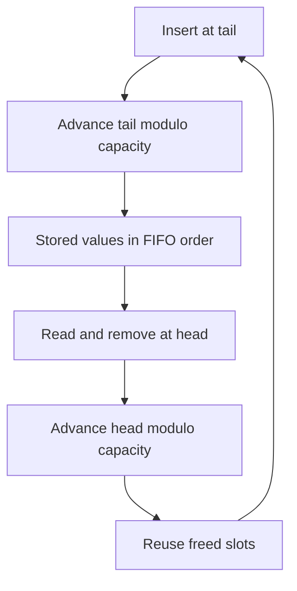

# Ring Buffer

Adapted from the supplied “Ring Buffer” learning note. This document explains the data structure, this Go implementation, and how the same idea is used in eBPF.

## What is a ring buffer?

A ring buffer, also called a circular buffer, is a fixed-capacity data structure that reuses storage by wrapping its read and write positions back to the start.

The memory is not physically circular. It is a contiguous array. Index arithmetic creates the circular behavior.



The diagram shows successful operations. An insertion into a full buffer and a read from an empty buffer return failure without changing the buffer.

## Internal state

| Field | Purpose |
| --- | --- |
| `data` | Preallocated integer storage |
| `capacity` | Maximum number of stored values |
| `head` | Index of the next value to read |
| `tail` | Index of the next slot to write |
| `count` | Number of unread values |

Writing advances `tail`. Reading advances `head`. The capacity does not change.

### Wraparound with modulo

For capacity 5, positions follow `0 → 1 → 2 → 3 → 4 → 0`.

```go
nextIndex := (currentIndex + 1) % capacity
```

| Current index | Calculation | Next index |
| --- | --- | --- |
| 0 | `(0 + 1) % 5` | 1 |
| 1 | `(1 + 1) % 5` | 2 |
| 2 | `(2 + 1) % 5` | 3 |
| 3 | `(3 + 1) % 5` | 4 |
| 4 | `(4 + 1) % 5` | 0 |

### Full and empty states

Both full and empty buffers can have `head == tail`. This implementation uses `count` to distinguish them:

- Empty: `count == 0`.
- Full: `count == capacity`.
- Partly filled: `0 < count && count < capacity`.

All allocated slots are usable. See [why a separate count is needed](note-1.md).

## Full-buffer policies

| Policy | Behavior when full |
| --- | --- |
| Overwrite oldest | Discard the oldest unread value to store the new value |
| Reject new data | Reject the new value and keep all unread values |
| Block or wait | Wait for a consumer to free space |

This project uses **reject new data**. `Insert` returns `false` when full. It does not block or overwrite values.

## Go implementation

Create buffers with `NewRingBuffer`; the zero value is not ready for use. The constructor panics for zero or negative capacity.

| Operation | Result |
| --- | --- |
| `NewRingBuffer(capacity)` | Allocate a buffer with positive capacity |
| `Insert(value)` | Return `true` on success or `false` when full |
| `Read()` | Remove and return the oldest value with `true`, or return `(0, false)` when empty |
| `Len()` | Return the number of unread values |
| `Cap()` | Return the fixed capacity |
| `IsEmpty()` | Report whether no values remain |
| `IsFull()` | Report whether all slots are occupied |

`Read` is a consuming operation, not a peek. Always check its boolean result: `(0, true)` is a stored zero, while `(0, false)` means the buffer was empty. Read slots are cleared to zero, but `count`, not slot contents, determines whether data exists.

### Worked example

With capacity 5:

| Action | Physical storage | `head` | `tail` | `count` |
| --- | --- | --- | --- | --- |
| Create | `[0 0 0 0 0]` | 0 | 0 | 0 |
| Insert 10 through 50 | `[10 20 30 40 50]` | 0 | 0 | 5 |
| Read 10 and 20 | `[0 0 30 40 50]` | 2 | 0 | 3 |
| Insert 60 and 70 | `[60 70 30 40 50]` | 2 | 2 | 5 |

The remaining FIFO order is **30, 40, 50, 60, 70**, not the left-to-right physical storage order.

### Cost and limits

- Construction takes O(capacity) space and initializes the backing storage.
- `Insert`, `Read`, and the state methods take O(1) time.
- Successful operations reuse the backing slice without growing it.
- The implementation stores `int` values only.
- It has no synchronization. Concurrent access requires external synchronization, including calls to the state methods when another goroutine can modify the buffer.
- It is a runnable learning example in `package main`, not an importable library or an eBPF implementation.

## Ring buffers in eBPF

Linux `BPF_MAP_TYPE_RINGBUF` transfers events from eBPF programs in the kernel to a userspace consumer. Common events include process execution and network activity.

A typical reserve-and-submit flow is:

1. An eBPF program detects an event.
2. It reserves space in the ring buffer.
3. If reservation fails, it handles the lost event rather than waiting for space.
4. It writes event data into the reserved space.
5. It submits the event, or discards the reserved record.
6. A userspace application reads submitted records.
7. Consumed space becomes reusable.

Important differences from this Go example:

- **Multiple producers, single consumer (MPSC):** producers can run on different CPUs.
- **Byte capacity and variable-length records:** capacity is not a count of integer slots. The map size must be a power of two.
- **Reservation order:** records become available in reservation order. A producer that has not submitted its earlier record can delay consumption of later records.
- **Reservation failures:** insufficient space causes failure without overwriting unread data. In NMI context, lock contention can also cause failure even when space exists.
- **Memory mapping:** userspace maps the data area for efficient consumption. Reserving and writing directly into a record avoids the extra copy used by the output helper.

The Go example demonstrates bounded storage, FIFO reads, and wraparound only. It does not implement kernel synchronization, record reservation, memory mapping, or event notifications.

### Why ring buffers fit event streaming

1. Preallocated storage bounds memory usage.
2. Shared storage can use memory more efficiently than separate per-CPU buffers.
3. Reservation ordering preserves the ordering of events that occur sequentially across CPUs.
4. Producers do not wait for a slow userspace consumer to free capacity; reservations fail when space is unavailable.

### Ring buffer versus other BPF maps

| Feature | BPF ring buffer | BPF hash map | BPF perf buffer |
| --- | --- | --- | --- |
| Main purpose | Event streaming | Keyed state | Event streaming |
| CPU layout | Can share a buffer across CPUs | Depends on map type | Typically per-CPU buffers |
| Ordering | Reservation order within one ring | Not a FIFO stream | No global ordering across CPU buffers |
| Capacity | Bounded | Bounded by configured limits | Bounded |
| Typical use | Process or network events | Counters and lookups | Per-CPU event streams |

Choose a ring buffer when userspace needs a stream of events. Choose a hash map when the kernel mainly needs to keep keyed state, such as packet counts by IP address.

## References

- [Linux kernel: BPF ring buffer design, APIs, and implementation](https://kernel.org/doc/html/latest/bpf/ringbuf.html)
- [Project README](../README.md)
